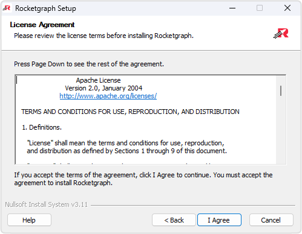

# License Page

  

Before installing **Rocketgraph**, please review the software license agreement carefully.  
The license outlines the terms and conditions for using Rocketgraph, including usage rights, restrictions, and any obligations you must follow.

---

## Why the License Matters

The license ensures that:
- You understand your rights and limitations when using Rocketgraph.
- You agree to comply with restrictions on distribution and modification.
- You acknowledge any requirements for commercial or enterprise usage.

---

## 📄 License Content

- Usage terms for personal and commercial environments  
- Limitations on redistribution and reverse engineering  
- Liability and warranty disclaimers  
- Instructions on providing a valid license file (if required)

---

## ✅ Before You Proceed

- Confirm that you have read and understood the license.  
- Ensure you have a valid license file, if applicable.  
- Only continue if you agree to the terms.

---

Once you've reviewed the license, click **I Agree** to proceed to the [Options Page](options.md).

[← Back to Welcome Page](welcome.md) • [Next → Options Page](options.md)
